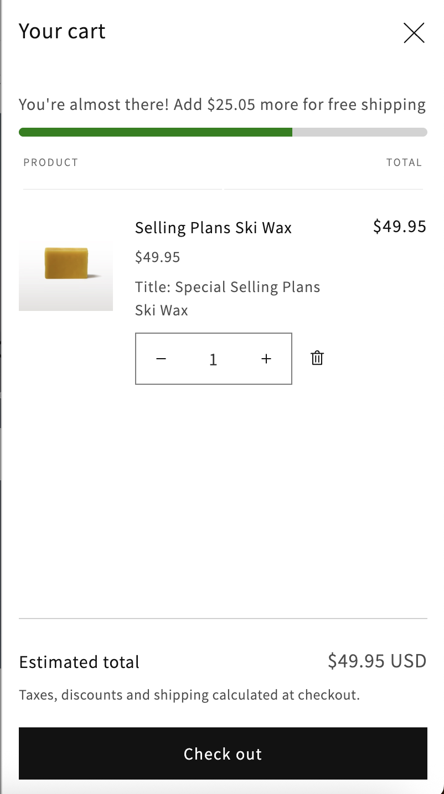
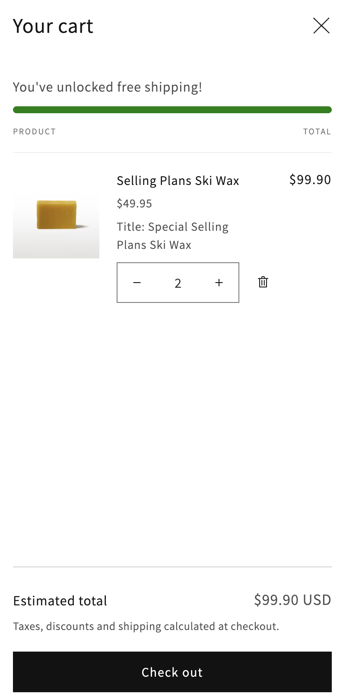
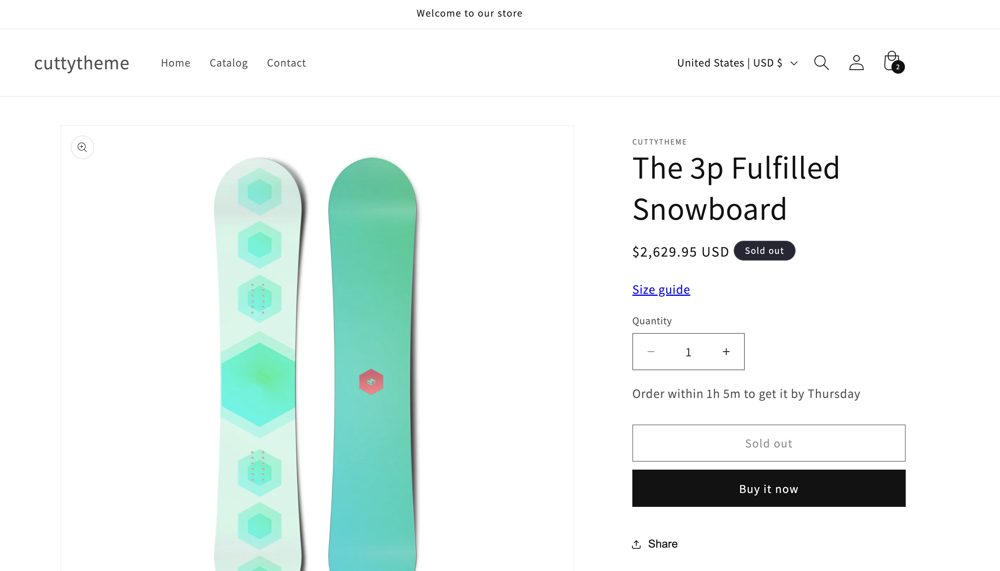
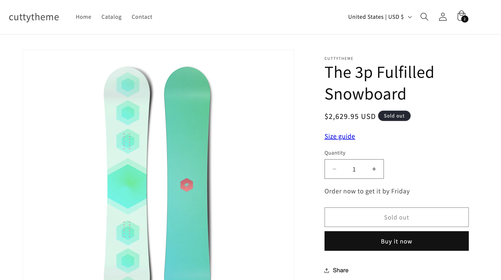

# Cutty Theme
A Shopify theme built on Dawn 16.0.0 as a learning and portfolio project

## What's included
- Hero banner section
- Featured collection section
- FAQ accordion section
- Shipping note block
- Size guide block
- Free shipping progress bar
- Delivery estimator block
- Riding style block

## Free Shipping Progress Bar

A progress bar that shows how close a customer is to free shipping. It appears on the cart page and in the cart drawer, and it updates live without a page reload.

### Features

- Shows the amount remaining, formatted with the store's money format, and a success message once the threshold is reached
- Updates live when quantities change, using Dawn's cart events and the Section Rendering API
- Works on the cart page and in the cart drawer from one shared snippet
- Separate thresholds for USD and CAD, set in Theme settings
- Hidden in an empty drawer, and for any currency without a configured threshold
- Accessible: `role="progressbar"` with `aria-valuenow`, and an `aria-live="polite"` message

### How it works

| File | Purpose |
|---|---|
| `snippets/free-shipping-bar.liquid` | Calculates the threshold, remaining amount, and percentage, and renders the `<free-shipping-bar>` element |
| `sections/free-shipping-bar.liquid` | Thin wrapper that places the snippet on the cart page |
| `snippets/cart-drawer.liquid` | Renders the same snippet below the drawer header |
| `assets/free-shipping-bar.js` | Custom element that subscribes to Dawn's cart update event |
| `assets/free-shipping-bar.css` | Styles for the track and fill |
| `config/settings_schema.json` | "Free shipping bar" theme settings |

**Live updates.** When Dawn publishes a cart update, the element fetches `?section_id=<id>` for its own section, parses the response, and copies the new fill width, message, and `aria-valuenow` onto the existing elements. Updating in place keeps the CSS width transition working and keeps the live region intact. Liquid does all the calculation, so the logic is not duplicated in JavaScript.

**Currency.** The snippet picks the threshold with `cart.currency.iso_code`. A currency with no configured threshold renders no bar.

### Settings

In the theme editor, open Theme settings, then Free shipping bar:

- Threshold (USD) and threshold (CAD)
- Progress message. Use `{amount}` where the remaining amount should appear.
- Success message

### Known limitations

- The bar is display only. The thresholds must be kept in sync manually with the free shipping rates in Shipping and delivery settings.
- One threshold setting per currency. A store with many currencies would need a different approach, such as a metaobject.
- Screen reader testing: the message update was announced with Safari + VoiceOver, but not with Brave + VoiceOver.
- Tested manually. There are no automated tests yet.

## Delivery estimator
A product page block that displays the estimated delivery date with a live countdown to the cutoff time

### Features
- Lead time set per product
- The countdown updates live, with no page reload
- The block is hidden when the lead time field is empty
- Shows static text (for example, '2 business days') when JavaScript is unavailable
- Delivery date counts business days and skips weekends
- After the cutoff hour, the estimate starts counting from the next business day

### How it works
- Liquid outputs three stable facts: `data-lead-time`, `data-cutoff-hour`, and `data-timezone`
- JavaScript computes the current time (now) in the store timezone to avoid stale data because pages can be cached

### Files
| File | Purpose |
|---|---|
| `sections/main-product.liquid` | Renders `<delivery-estimator>` element on the product page |
| `assets/delivery-estimator.js` | Custom element that calculates the delivery dates |
| `config/settings_schema.json` | "Delivery estimate" theme settings |

### Set up
- Create the product metafield definition with name `Delivery lead time (days)`, type `Integer`, and key `custom.delivery_lead_time_days`
- Set a value for `Delivery lead time (days)` on each product that should show an estimate
- Set a value for `Delivery timezone` and `Delivery cutoff hour` in Theme settings
- Add the block to the product template in the editor

### Settings
- Theme settings: "Delivery estimate" group: cutoff hour (integer slider from 0 to 23, default 14), timezone (an IANA name, default America/Los_Angeles)
- Lead time (an integer), edited in the Metafields card on the product page in the admin

### Known limitations
- The timezone and cutoff are theme settings, not read from the store admin, so they have to be kept in sync manually
- A wrong device clock produces a wrong countdown and delivery day
- Holidays aren't handled
- Business days are fixed to Monday through Friday
- The cutoff is store-wide, not per product
- The timezone is typed as an IANA name. An invalid name logs an error in the browser console, and the element keeps its static fallback text.
- The estimate comes from the product's lead time and the store cutoff, not from carrier rates, and Shopify's own estimates at checkout are calculated separately, so the two dates can differ
- The countdown has no live region, so screen readers don't announce it as it updates, which is deliberate
- Tested manually. There are no automated tests yet

### Why custom instead of an app or Shopify's delivery estimates
- A theme-native block has no monthly fee and loads no third-party script
- Works with any shipping provider or rate type
- Appears on the product page, with a countdown and a per-product lead time

## Riding style block
A product page block that shows a riding style (name, description and best conditions) from a metaobject entry.

The content is stored once per style, and any number of products can reference it. Editing a style entry updates every product that uses it, with no theme edit. The block renders nothing when a product has no style set.

### Setup
1. Create a metaobject definition `Riding style` (handle `riding_style`) with three fields: `name`, `description` and `best_conditions`.
2. Create the entries, for example All-mountain, Freestyle and Powder.
3. Create a product metafield definition `Riding style` (namespace and key `custom.riding_style`) as a reference to a single `Riding style` entry.
4. Set a style on each product that should show one.
5. Add the Riding style block to the product template in the theme editor.

### Known limitations
- One style per product. A product that suits several styles would need a list of references.
- The sample entries are generic descriptions for demonstration, not product specifications.

## Development setup

**Requirements**
- Node.js v24.21.0
- Shopify CLI 4.8.5
- A Shopify store with a development theme

**Run it**
1. Clone the repo and `cd` into it.
2. Start the dev server: `shopify theme dev --store <your-store> --theme-editor-sync`
3. Open the local preview URL the CLI prints (`http://127.0.0.1:9292`).
4. To use the theme editor, open the editor link the CLI prints, so the preview includes your local code.

**Working with editor changes**
- `--theme-editor-sync` writes editor changes (section placement, theme settings) back into your local JSON files. Without it, those changes exist only on the dev theme.
- Structure and settings are edited in the theme editor. Liquid, CSS and JS are edited in VS Code. Avoid editing the same JSON file in both places at once.

## Credits
Built on [Dawn](https://github.com/Shopify/dawn) by Shopify, MIT licensed. The original license is kept in LICENSE.md.